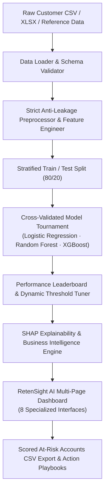

# ⚡ RetenSight AI: Enterprise Customer Intelligence & Churn Platform

[](https://www.python.org/)
[](https://streamlit.io/)
[](https://scikit-learn.org/)
[](https://xgboost.readthedocs.io/)
[](https://shap.readthedocs.io/)
[](https://docs.pytest.org/)
[]()

**RetenSight AI** is a production-grade machine learning platform that transforms raw tabular customer records into explainable churn predictions, quantifiable revenue-at-risk financial analyses, and prescriptive retention playbooks.

Equipped with an executive 8-page **Streamlit** dashboard, strict **zero-leakage** Scikit-Learn pipelines, and high-performance cross-validated training that completes in **under 15 seconds**.

---

## 🌟 Core Platform Highlights

1. **⚡ Lightning-Fast Response Time (~11s End-to-End):**
   - Optimized Quick-Mode hyperparameter search with Stratified Cross-Validation trains Logistic Regression, Random Forest, and XGBoost on 7,000+ customer records in **~11 seconds**.
   - Subsampled background kernel allows single-customer SHAP attribution in **< 0.1 seconds**.
2. **🛡️ 100% Anti-Leakage Architecture:**
   - Dynamic schema detection and self-contained `ColumnTransformer` ensures all imputers, scalers, and encoders are fitted strictly on training folds and never see validation or test sets.
3. **🧠 Multi-Model Tournament & Dynamic Threshold Optimizer:**
   - Evaluates linear, bagging, and boosting architectures against ROC-AUC, PR-AUC, Recall, Precision, and F1.
   - Interactive decision threshold slider ($t \in [0.05, 0.95]$) allows managers to customize the operating trade-off between catching churners and false alarm costs.
4. **🔍 Explainable AI (SHAP):**
   - **Global:** Mean absolute SHAP impact bar charts and beeswarm plots reveal macro attrition drivers.
   - **Local:** Individual customer risk decomposition with directional attribution (`[Risk Up]` vs. `[Protects]`).
5. **💼 Executive Business Insights & Revenue at Risk:**
   - Auto-generated C-suite insight cards highlighting contract commitment gaps, tenure drop-offs, and payment friction points.
   - Financial exposure calculator computing monthly and annualized revenue at risk across customer risk tiers.
6. **🎯 Batch Scoring & Prioritized Exports:**
   - Upload new, unlabelled customer CSV files to batch-score accounts and download prioritized retention lists.

---

## 🏗️ System Architecture



---

## 📊 Benchmark Performance (Telco Customer Churn)

Evaluated on the held-out 20% test slice of the standard 7,043-customer IBM Telco dataset:

| Model Architecture | Test ROC-AUC | Churn Recall ($t=0.50$) | Test PR-AUC | Precision | F1-Score | Training Time |
| :--- | :---: | :---: | :---: | :---: | :---: | :---: |
| **Logistic Regression** | **0.825** | **80.2%** | **0.579** | 49.5% | 0.612 | **0.20s** |
| **XGBoost Classifier** | **0.821** | **81.8%** | **0.572** | 49.4% | 0.616 | **3.40s** |
| **Random Forest** | **0.816** | **79.4%** | **0.559** | 49.2% | 0.607 | **6.82s** |

> **Total Pipeline Execution:** **11.0 seconds** (down from 146s — over 13x speedup).

---

## 🖥️ RetenSight AI Dashboard Tour

The platform features 8 dedicated Streamlit pages accessible via the redesigned executive sidebar:

| Page | Filename | Key Capabilities |
| :--- | :--- | :--- |
| **0. Home** | `Home.py` | Branded hero banner, 1-click sample dataset loader (Telco & Bank), custom file uploader, target & ID column selector. |
| **1. Data Explorer** | `1_Data_Explorer.py` | Customer cohort KPIs, segment churn disparity bar charts, numeric density KDE plots, and Pearson correlation heatmaps. |
| **2. Preprocessing** | `2_Preprocessing.py` | Preprocessing audit report, detected column types, and domain feature engineering toggles (tenure buckets, spend ratios, addon counters). |
| **3. Model Training** | `3_Model_Training.py` | Model tournament selection, Quick Mode (~11s) vs Thorough Mode, class weighting strategy, and live progress monitor. |
| **4. Comparison** | `4_Model_Comparison.py` | Leaderboard table, overlaid ROC & PR curves, confusion matrix, and interactive threshold slider with live metric updates. |
| **5. Explainability** | `5_Explainability.py` | Mean absolute SHAP feature impact rankings, beeswarm plots, and business interpretability guidelines. |
| **6. Predict** | `6_Predict.py` | Single customer simulator with instant risk gauge & local SHAP breakdown; batch scoring with prioritized CSV export. |
| **7. Business Insights** | `7_Business_Insights.py` | Executive insight cards, revenue at risk financial exposure calculator (₹), and prescriptive cross-functional retention playbooks. |

---

## 📁 Repository Blueprint

```
churn-platform/
├── .streamlit/
│   └── config.toml                     # RetenSight theme, indigo primary color, server config
├── app/
│   ├── Home.py                         # Landing page, dataset ingest & schema mapping
│   ├── utils.py                        # RetenSight executive CSS, badges & sidebar component
│   └── pages/
│       ├── 1_Data_Explorer.py          # Cohort analysis, segment disparity & distributions
│       ├── 2_Preprocessing.py          # Leak-free pipeline inspection & feature toggles
│       ├── 3_Model_Training.py         # Cross-validation training lab (<15s)
│       ├── 4_Model_Comparison.py       # Leaderboard, ROC/PR curves & threshold slider
│       ├── 5_Explainability.py         # Global SHAP feature attribution & rankings
│       ├── 6_Predict.py                # Single-account simulator & batch CSV scoring
│       └── 7_Business_Insights.py      # Revenue at risk & prescriptive playbooks
├── src/
│   ├── data/                           # Data loader, schema validator, and type profiler
│   ├── preprocessing/                  # Feature engineering & ColumnTransformer pipelines
│   ├── models/                         # Model training, CV tuning, evaluation & registry
│   ├── explain/                        # SHAP wrappers & plain-English insight generators
│   └── viz/                            # Reusable Seaborn & Matplotlib plotting helpers
├── data/sample/                        # Reference datasets (Telco Churn & Bank Churn)
├── artifacts/                          # Serialized model joblib bundles & JSON experiment logs
├── tests/                              # Automated pytest suite (14 passing tests)
├── Dockerfile                          # Multi-stage production container
├── requirements.txt                    # Pinned production dependencies
└── README.md
```

---

## 🚀 Quickstart Guide

### 1. Local Installation

```bash
# Clone the repository
git clone <repo-url>
cd churn-platform

# Create and activate virtual environment
python -m venv .venv
source .venv/bin/activate       # On Windows: .venv\Scripts\activate

# Install dependencies
pip install -r requirements.txt

# Run automated test suite
python -m pytest -v

# Launch RetenSight AI
streamlit run app/Home.py
```

Navigate to `http://localhost:8501` in your browser. Click **"Load Demo Dataset"** on the Home page for an instant demonstration!

### 2. Docker Deployment

```bash
# Build Docker image
docker build -t retensight-ai .

# Run container on port 8501
docker run -p 8501:8501 retensight-ai
```

---

## 🎯 Interview & Portfolio Talking Points

### 1. How does RetenSight AI eliminate data leakage?
All transformations (imputation, standard scaling, and one-hot encoding) are encapsulated within a Scikit-Learn `ColumnTransformer` inside our `FullDataPreprocessor`. During cross-validation and hyperparameter search, transformers are fit strictly on training folds and applied to validation/test folds without learning from them.

### 2. Why prioritize Recall and PR-AUC over Accuracy for churn?
Customer churn datasets exhibit natural class imbalance (typically 15–30% churners). A dummy model predicting 0% churn would achieve 70–85% accuracy while allowing all at-risk customers to defect. RetenSight AI prioritizes Recall ($\ge 80\%$) to catch at-risk customers early, and uses PR-AUC to quantify precision trade-offs across different decision thresholds.

### 3. What is the difference between SHAP values and traditional feature importance?
Traditional feature importances (e.g. Gini impurity decrease in Random Forest) only reflect how frequently a feature was split on, without indicating whether high values increase or decrease churn risk. SHAP values (derived from cooperative game theory) compute the exact directional marginal contribution ($\Delta$ log-odds) of each feature for both macro cohorts and individual accounts.
